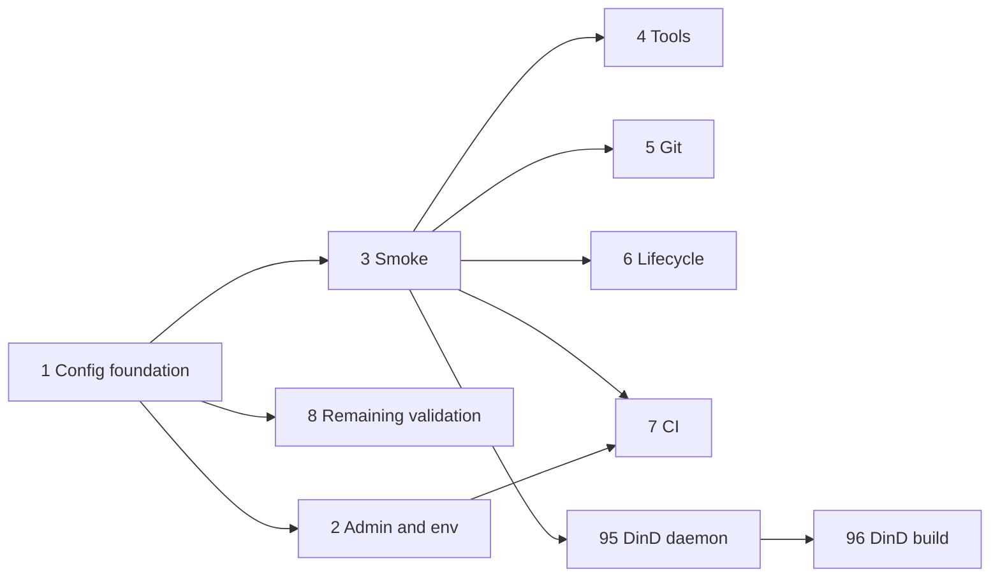

# Meta-Repo Test Suite

Build the tests in small layers:

- `./tests/run.sh config` tests `apply.sh` using isolated temporary fixtures.
- `./tests/run.sh smoke` builds a disposable Dev Container and checks its runtime contract.
- `./tests/run.sh lifecycle` rebuilds the container and verifies persistent state survives.
- `./tests/run.sh all` runs every suite; the default remains the fast `config` suite.

The tests must never touch the developer's active container or volumes. Fast config tests run on pull requests; full container tests run on relevant main-branch changes, on a schedule, and manually.

Conversation persistence is tested automatically with sentinel files and manually by resuming real Claude and Copilot conversations. Docker-in-Docker coverage is parked as Tasks 95 and 96.

## Assessment (11 November 2026)

The layering is sound and the tasks are small enough to do one at a time. The review below was made against `apply.sh`, the Dockerfile, the entrypoint and Dev Container CLI 0.90.0. Each task file has its own **Caveats** section; these are the points that cut across tasks.

### Gaps that were filled

This overview promised things no task delivered. Three tasks were added:

| Promise in this overview | Was covered by | Now |
|---|---|---|
| `./tests/run.sh lifecycle` and sentinel-file persistence | nothing | Task 6 |
| Tests on pull requests, main, a schedule and manually | nothing | Task 7 |
| Manual resume of real Claude and Copilot conversations | nothing | Checklist in Task 6 |
| Most of `apply.sh`'s validation (ports, ignore, dotfiles, proxies, name clashes) | nothing | Task 8 |

### Cross-cutting caveats

- **The fixture needs its own `meta-repo.yaml`.** The committed one lists personal folders, a bot Git identity, ports and env keys. A plain copy fails validation, because those folders don't exist under the fixture root, and `meta-repo.local.yaml` can add folders but never remove them.
- **The fixture must publish no ports.** The committed list binds `127.0.0.1:13000` and others. A smoke container with the same list collides with the developer's running container, which breaks the "never touch" rule.
- **Isolation rests on the Compose project name.** It prefixes every volume and names the image. Give each run a unique `metarepo_suffix` under a fixed test `metarepo_id`, and make cleanup refuse to act on any project without that prefix.
- **The Dev Container CLI is not VS Code.** It ignores everything under `customizations.vscode`, and applies `remoteUser` and `remoteEnv` only through `devcontainer exec`. Several Task 5 checks therefore pass without proving anything. See Task 5.
- **The image installs the latest of nearly everything.** A smoke failure can come from upstream rather than from a change here. That makes the scheduled run valuable, and makes smoke a poor merge gate.
- **`apply.sh` supports macOS bash 3.2.** The config suite should hold to the same limit, or it can't run where the script is used most. No associative arrays, no `mapfile`, no GNU-only flags.
- **`apply.sh` reads `$HOME` and the caller's environment.** Run it with a temporary `HOME` and a scrubbed environment, so results don't depend on the machine.
- **The entrypoint is untested.** Volume ownership fixes and the `~/.claude.json` symlink are what make persistence work. Task 6 now covers them.
- **`docs/plan/workspace-layout.md` proposes moving things.** If that lands first, fixture paths and expected mount targets change. Keep expectations in one helper so only one place needs updating.
- **This is a template.** Repos created from it inherit `tests/` and any workflows, including scheduled ones. See Task 7.

### Suggested order

Task 7 can land twice: once after Task 2 for the pull-request job, and again after Task 3 for the container jobs.

## Recommended Anthropic models

Each task file repeats its own recommendation.

| Task | Model | Why |
|---|---|---|
| 1 Config foundation | Claude Opus 5.5 | Sets the harness every later task copies. Needs judgement on isolation, bash 3.2 limits and assertion helpers. |
| 2 Admin and required env | Claude Sonnet 5.5 | Two cases on an existing pattern. |
| 3 Disposable smoke | Claude Opus 5.5 | Long build-and-debug loop, and cleanup that must not be wrong. |
| 4 Installed tools | Claude Sonnet 5.5 | A list of checks. Some shell-environment subtlety with nvm. |
| 5 Git identity | Claude Sonnet 5.5 | Small, and the traps are now written down. |
| 6 Lifecycle | Claude Opus 5.5 | Has to prove the container was really recreated, and reason about volume ownership. |
| 7 CI | Claude Sonnet 5.5 | Standard workflow authoring. |
| 8 Remaining validation | Claude Sonnet 5.5 | Table-driven cases. Claude Haiku 5.5 is enough once Task 1's helpers exist. |
| 95 DinD daemon | Claude Sonnet 5.5 | Short check. |
| 96 DinD build and run | Claude Sonnet 5.5 | Short check with careful cleanup. |

Claude Fable 5.2 isn't needed for any task as planned. Reach for it only if Task 3 or 6 stalls on a container problem that Opus can't diagnose. Tasks 3 to 6, 95 and 96 need an agent session with a working Docker daemon; a session without one can write the scripts but can't verify them.
