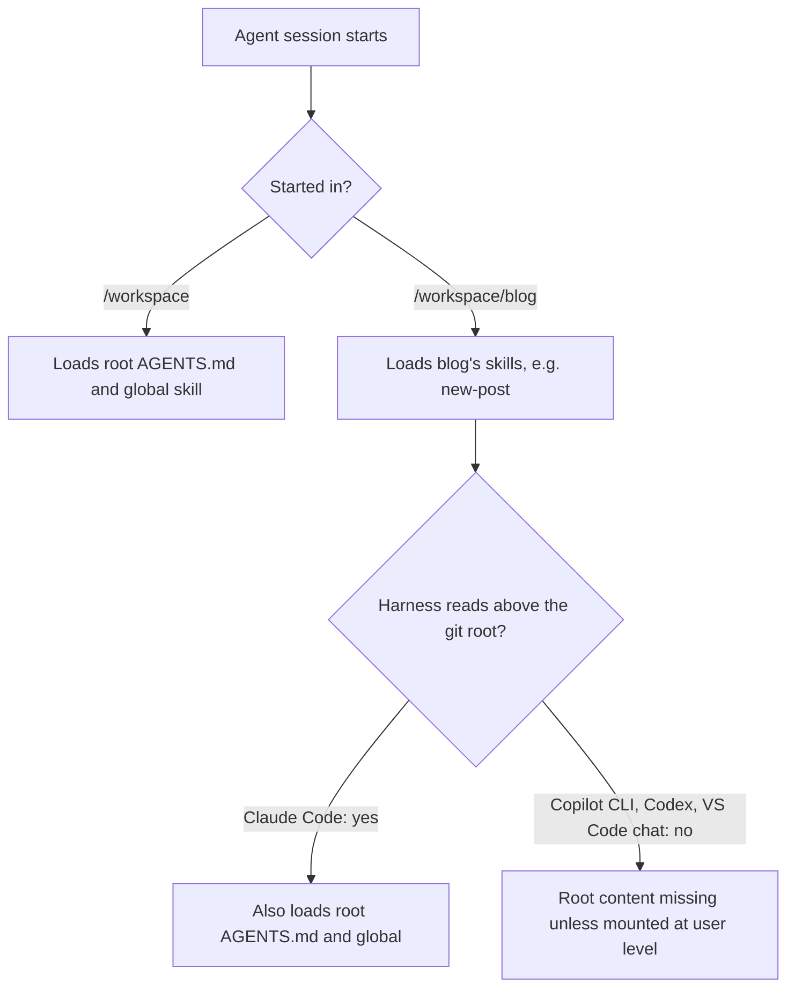

# Workspace layout: one model for single and multi-repo containers

Proposal, 28 October 2026. Not implemented yet.

## Intent

- **Run agents with looser permissions inside a container**, with access only to the repos you choose.
- **Support several repos in one container.** That's the normal case.
- **Let a container be a single version-controlled unit.** A project repo can carry its own container setup, so cloning it gives you the container.
- **Add repos later without restructuring.** A project that starts on its own must be able to gain `agent-skills`, `dot-files` or `blog` alongside it.
- **Scope skills to where they're relevant.** Root-level content applies everywhere. A repo's own skills apply only when working in that repo, so `blog`'s `new-post` skill doesn't appear while working on `my-new-thing`.
- **Drop the team-sharing focus (YAGNI).** The committed/local config split existed for teams. Keep only what's needed to hold host paths and personal extras out of commits.

## The model

The instance is the repo or directory that holds `.devcontainer/`. It's always mounted as `/workspace/<name>`, never as `/workspace` itself. `/workspace` is a plain directory, never a git repo.

| Source | Ends up at |
|---|---|
| `<instance>/.devcontainer/root/*` | `/workspace/*` (root `AGENTS.md`, global skills) |
| The instance | `/workspace/<instance name>/` |
| Each listed repo | `/workspace/<repo name>/`, unchanged |

Extra repos are listed by who they're for:

| Scope | File | Committed? |
|---|---|---|
| Project | `meta-repo.yaml` | yes |
| This checkout, just for you | `meta-repo.local.yaml` | no |
| You, in every container | `~/.config/metarepo/config.yaml` (also holds `root`) | no, it's in your home directory |

## Example

**Host**

```
~/git-workspace/
├── my-new-thing/                      # the instance, a git repo
│   ├── .agents/skills/
│   │   └── foo/SKILL.md               # only relevant to my-new-thing
│   └── .devcontainer/
│       └── root/
│           ├── AGENTS.md              # "be zany in your replies"
│           └── .agents/skills/
│               └── global/SKILL.md    # relevant everywhere
├── agent-skills/
└── blog/
    └── .agents/skills/
        └── new-post/SKILL.md          # only relevant to blog
```

**Container**

```
/workspace/
├── AGENTS.md              ← my-new-thing/.devcontainer/root/AGENTS.md
├── .agents/skills/
│   └── global/SKILL.md    ← my-new-thing/.devcontainer/root/.agents/skills/global
├── my-new-thing/
│   └── .agents/skills/
│       └── foo/SKILL.md
├── agent-skills/
└── blog/
    └── .agents/skills/
        └── new-post/SKILL.md
```

## How skills get scoped

Scoping comes from where the agent session starts. Nested repo skills are deliberately not loaded from `/workspace`.



- **CLI:** `cd /workspace/blog` before starting the harness.
- **VS Code:** use the Agents window's folder picker to start a session in one repo.
- **Root content:** because most harnesses stop at the git root, `apply` should also mount `.devcontainer/root/` at the user-level locations (`~/.agents/skills`, `~/.claude/skills`, `~/.copilot/skills`, and each harness's user instructions file). That makes it load in every session regardless of starting directory.

See [agent-skill-discovery-2026-10-28.md](../research/agent-skill-discovery-2026-10-28.md) for the evidence behind each harness's behaviour.

## Open questions

- Confirm the user-level mounts work for each harness in a scratch container, given `~/.claude` and `~/.copilot` are already volumes.
- How engine updates reach instances: vendored files with `metarepo update`, or a published base image.
- Whether a root `use-repo` skill should tell agents which repo to work in when a session starts at `/workspace`.
