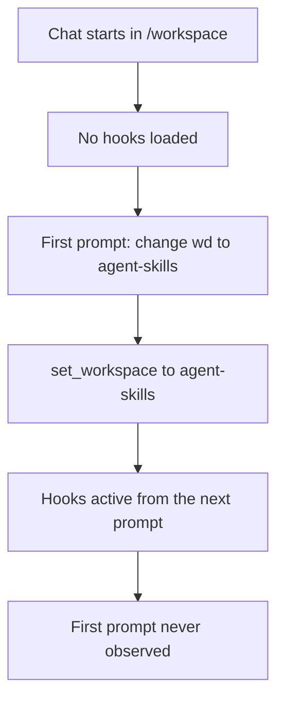

# Hooks not firing in agent-skills: findings and suggestions

Date: 2026-10-29. Subject: the `skill-observer` hooks in `agent-skills/.github/hooks/skill-observer.json`.

## Summary

The hooks do fire. In session `e74b3679-9113-409d-b328-ece87c7266a4` the observer log shows turns 1-3 handled, and turn 2 logged `blocked create (main), injected ts-write-script`. The problem is narrower: hooks load from the folder the chat is rooted in, so they miss anything that happens before that folder is right.

## Likely causes

- **Chat started outside the repo.** The first prompt never reached the hook. The observer's `prompts` list starts with the injected "Only this chat now uses…" message.
- **Hooks added after the session began.** `.github/` was created after the chat was opened, and hooks are read at session start.
- **Narrow `preToolUse` matcher.** It only matches `create|edit|apply_patch|str_replace_editor`, so `bash` writes never trigger it.
- **Silent failures.** Every command ends in `|| true`, so a missing `bun`, a bad path or a crash leaves no trace. The relative `cwd` of `.` also depends on the host resolving it to the repo root.
- **Unsupported events.** A chat with no workspace folder, or a client without `preCompact` support, shows nothing for those hooks.

## How to start a chat in agent-skills

Do this instead of switching with `set_workspace` mid-chat.

- Open the folder as the window root: `code /workspace/agent-skills`, then start a new chat.
- Or add `agent-skills` as a workspace folder and confirm it is the chat's root.
- Or use the Copilot CLI: `cd /workspace/agent-skills && copilot`.

## Verifying

Check `/tmp/skill-observer-<uid>/<session-id>.log`. If the first prompt appears in the `prompts` list of the matching `.json`, the hooks loaded from the start.

## Suggestions

- Always create the chat after the target folder is open.
- Drop `|| true`, or log failures to the observer log, so errors are visible.
- Widen the `preToolUse` matcher if `bash` writes should be observed.
