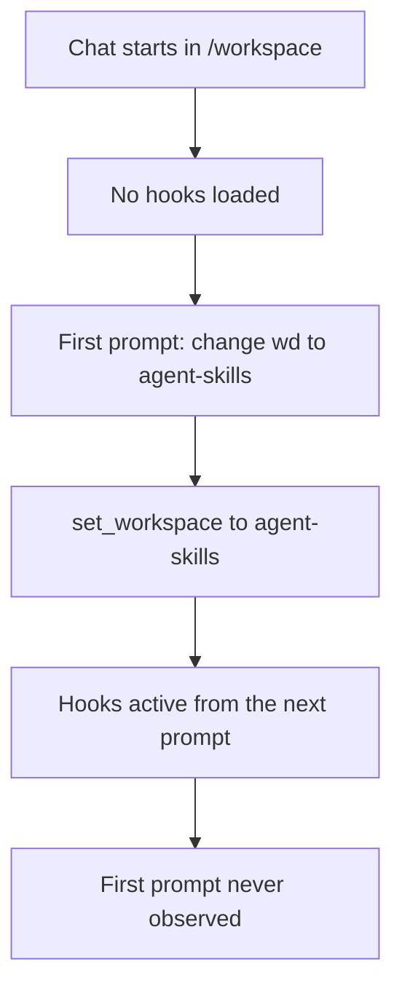

# Hooks not firing in agent-skills: findings and suggestions

Date: 2026-10-29. Subject: the `skill-observer` hooks in `agent-skills/.github/hooks/skill-observer.json`.

## Summary

The hooks do fire. In session `e74b3679-9113-409d-b328-ece87c7266a4` the observer log shows turns 1-3 handled, and turn 2 logged `blocked create (main), injected ts-write-script`. The problem is narrower: hooks load from the folder the chat is rooted in, so they miss anything that happens before that folder is right.

## Likely causes

- **Chat started outside the repo.** The first prompt never reached the hook. The observer's `prompts` list starts with the injected "Only this chat now uses…" message.
- **Hooks added after the session began.** `.github/` was created after the chat was opened, and hooks are read at session start.
- **Narrow `preToolUse` matcher.** It only matches `create|edit|apply_patch|str_replace_editor`, so `bash` writes never trigger it.
- **Silent failures.** Every command ends in `|| true`, so a missing `bun`, a bad path or a crash leaves no trace. The relative `cwd` of `.` also depends on the host resolving it to the repo root.
- **Unsupported events.** A chat with no workspace folder, or a client without `preCompact` support, shows nothing for those hooks.

## How to start a chat in agent-skills

Do this instead of switching with `set_workspace` mid-chat.

- Open the folder as the window root: `code /workspace/agent-skills`, then start a new chat.
- Or add `agent-skills` as a workspace folder and confirm it is the chat's root.
- Or use the Copilot CLI: `cd /workspace/agent-skills && copilot`.

## Verifying

Check `/tmp/skill-observer-<uid>/<session-id>.log`. If the first prompt appears in the `prompts` list of the matching `.json`, the hooks loaded from the start.

## Suggestions

- Always create the chat after the target folder is open.
- Drop `|| true`, or log failures to the observer log, so errors are visible.
- Widen the `preToolUse` matcher if `bash` writes should be observed.

## Related GitHub issues

Searched `github/copilot-cli` and `microsoft/vscode`. No issue covers hooks not reloading after a mid-chat workspace change (`set_workspace`). If it should be reported, `microsoft/vscode` is the likelier home.

Closest matches in `github/copilot-cli`:

- [#4520](https://github.com/github/copilot-cli/issues/4520), open: a standalone `.github/hooks/*.json` `postToolUse` hook (not from a plugin) never fires.
- [#1730](https://github.com/github/copilot-cli/issues/1730), open: a `sessionStart` hook in `.github/hooks/` does not fire in v0.0.420.
- [#3167](https://github.com/github/copilot-cli/issues/3167), closed: `preToolUse` silently dropped after a mid-loop `extensions_reload`, from a stale snapshot. The nearest to "hooks go stale mid-session".
- [#2540](https://github.com/github/copilot-cli/issues/2540), open: plugin-defined `preToolUse` hooks do not fire in the main session or in subagents.
- [#2893](https://github.com/github/copilot-cli/issues/2893), open: `preToolUse` hooks silently bypassed under parallel tool calls, through a timeout-to-allow fallback. Relevant because the denied `create` in session `401559ce` ran in a parallel batch with `bash`.
